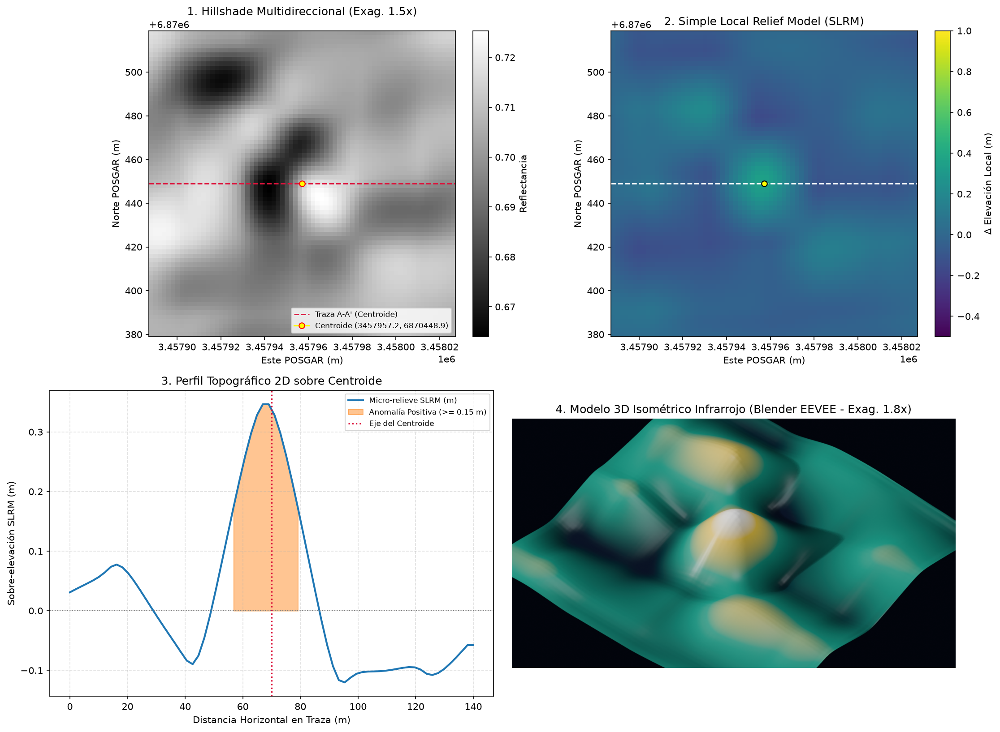
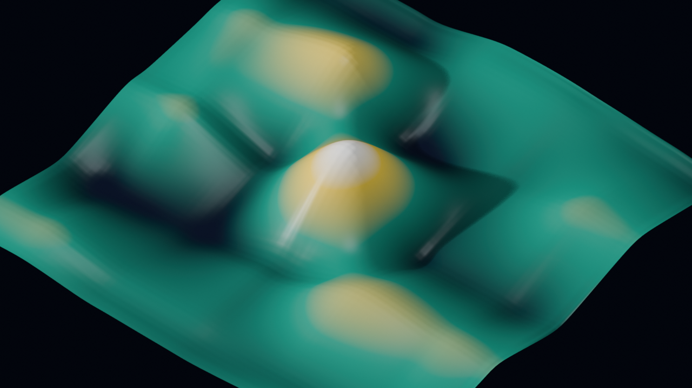
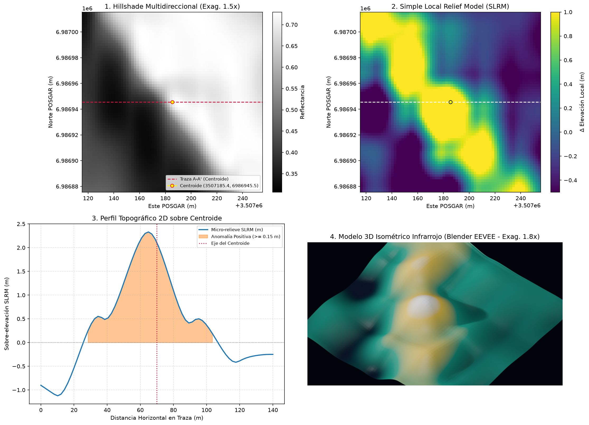
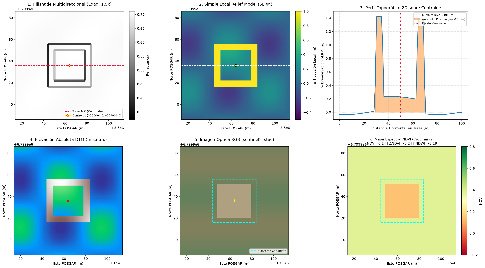

# ArchaeoLiDAR-AR: Plataforma Autónoma Multisatélite para Prospección Arqueológica, Vigilancia de Saqueo y Documentación Patrimonial en Argentina

[](https://www.python.org/)
[](#8-verificaci%C3%B3n-y-reproducibilidad)
[-orange.svg)](#22-reproyecci%C3%B3n-geod%C3%A9sica-y-presupuesto-de-memoria)
[-red.svg)](#9-confidencialidad-geod%C3%A9sica-y-cumplimiento-de-la-ley-n-25743)

> **Para usuarios no técnicos:** empezá por el **[Manual de Uso paso a paso](MANUAL_DE_USO.md)** (por escenarios, con ejemplos visuales y glosario).  
> **Para operación con agentes de IA (Antigravity / MCP):** consultá el skill oficial en [`.agents/skills/archaeo-lidar-prospector/SKILL.md`](.agents/skills/archaeo-lidar-prospector/SKILL.md) y el [README técnico del servidor FastMCP](archaeo-lidar-mcp/README.md).

---

## Resumen (*Abstract*)

La teledetección arqueológica en la República Argentina enfrenta tres desafíos estructurales: (i) la cobertura heterogénea de datos LiDAR sub-métricos frente a la vasta extensión territorial; (ii) la diversidad de biomas (desde la Puna y la Alta Montaña hasta las Yungas, la Selva Paranaense, los humedales del Litoral y la Meseta Patagónica); y (iii) la necesidad de resguardar las coordenadas exactas frente al tráfico ilícito y el saqueo (*guaqueo*) conforme a la **Ley Nacional N° 25.743**.

**ArchaeoLiDAR-AR** (`archaeo-lidar-mcp`) implementa un pipeline autónomo de ocho fases que integra:
1. **Enrutamiento DEM multisatélite por HTTP Range Request** (`Copernicus GLO-30`, `FABDEM` con remoción de dosel arbóreo, `ALOS AW3D30`, `IGN MDE-Ar` e ingesta LiDAR/UAV `< 1 m/px`).
2. **Modelado adaptativo de micro-relieve** (*Simple Local Relief Model* — SLRM, pendiente y detección morfométrica de **doble signo** para relieve positivo y negativo).
3. **Validación catastral y bibliográfica multifuente** (OpenStreetMap, IGN WFS, catálogo de sitios publicados y OpenAlex/Semantic Scholar).
4. **Ingesta óptica y multiespectral selectiva** (`Sentinel-2 L2A` con RGB + NDVI/NDWI, mosaicos `XYZ`/`IGN Argenmap` o `Google Earth Engine`), ejecutada únicamente sobre candidatos inéditos (`±150 m`).
5. **Inspección visual multimodal de hasta 6 paneles** con renderizado 3D isométrico en **Blender 4.2 LTS** y auditoría pericial **LLM-as-a-Judge** (criterios CONICET/NOA).
6. **Calibrador supervisado de Machine Learning** (`GradientBoostingClassifier` con 11 variables morfológicas y espectrales, validación cruzada `StratifiedGroupKFold` y *hard negatives* reales).
7. **Vigilancia patrimonial `ALERTA_SAQUEO`**, **inventario geomorfológico secundario** y generación automatizada de **dossiers INAPL** con anexo confidencial de coordenadas.

En la campaña nacional consolidada sobre **29 zonas y 2 relevamientos UAV** (**2.167 cuadrículas métricas**), el sistema aisló y auditó **121 anomalías**, logrando **0 falsas alarmas derivadas a campo** y catalogando **84 geoformas** reutilizables para hidrología y geomorfología.

---

## 1. Introducción y Motivación Científica

El uso de modelos digitales de terreno (DTM) derivados de LiDAR y sensores satelitales ha transformado la arqueología sudamericana al revelar asentamientos prehispánicos complejos bajo cobertura vegetal o en paisajes de difícil acceso (Canuto et al., 2018; Prümers et al., 2022). Sin embargo, en regiones sin cobertura LiDAR nacional uniforme, la prospección depende de combinar **DEM satelitales globales (30 m/px)** —útiles para estructuras monumentales, cerritos, terrazas extensas y recintos mayores— con **vuelos UAV/LiDAR científicos (< 1 m/px)** donde existan, y con **sensores ópticos multiespectrales** capaces de detectar marcas de vegetación (*cropmarks*) o trazas superficiales.

A diferencia de enfoques basados en redes convolucionales entrenadas sobre regiones europeas homogéneas (Verschoof-van der Vaart & Lambers, 2019; Trier et al., 2020; Orengo et al., 2020), **ArchaeoLiDAR-AR** adopta una arquitectura **adaptativa por bioma**, transparente en sus limitaciones de resolución física y diseñada explícitamente para el marco institucional y legal argentino (**INAPL — Ley N° 25.743**).

---

## 2. Arquitectura Multisatélite y Presupuesto Geodésico

```
                    [ FUENTES DE ELEVACIÓN / NUBES CRUDAS ]
                                       │
      ┌────────────────────────────────┼────────────────────────────────┐
      ▼                                ▼                                ▼
Nubes LiDAR (.laz/.las)       Vuelos UAV Científicos         Router DEM Multisatélite
• Filtrado SMRF (Clase 2)     • Zenodo / OpenTopo / IGN      • FABDEM (selvas/humedales)
• Resolución 0.05–1.0 m/px    • Preserva escala nativa       • Copernicus GLO-30 (AWS/STAC)
                                                             • ALOS AW3D30 / IGN WCS 5 m
      └────────────────────────────────┼────────────────────────────────┘
                                       ▼
          [ FASE 1: Reproyección POSGAR 2007 (EPSG:5343–5349) ]
            • Lectura parcial vía GDAL/VSICURL (HTTP Range Requests)
            • Tope estricto MAX_MASTER_SIDE_PX = 4096 | GeoTIFF Deflate
                                       │
                                       ▼
          [ FASE 2: Tiling Métrico (500 m, 15% solapamiento) + SLRM ]
            • Filtro Gaussiano NaN-safe + Pendiente (Horn 1981)
            • Detección morfométrica de doble signo (+ y -)
                                       │
                                       ▼
          [ FASE 3: Validación Catastral y Priorización ML ]
            • OSM Overpass + IGN WFS + Catálogo Sitios (SITIO_REGISTRADO)
            • Calibrador ML (11 features) + Vigilancia ALERTA_SAQUEO
                                       │
                                       ▼
          [ FASE 4: Ingesta Óptica Selectiva (solo CANDIDATO_INEDITO) ]
            • Parche ±150 m (tope 512×512 px): Sentinel-2 L2A / XYZ / GEE
            • Lámina 6 paneles (Hillshade, SLRM, Perfil, 3D/DTM, RGB, NDVI)
                                       │
                                       ▼
          [ FASE 5: Juez Pericial VLM + Documentación Ley 25.743 ]
            ├─► ANTROPICA  ──► MAPA_FINAL_PROSPECCION.geojson
            ├─► NATURAL    ──► DESCARTES_VLM.json + INVENTARIO_GEOMORFOLOGICO
            └─► ARTEFACTO  ──► DESCARTES_VLM.json (purga GeoJSON automática)
```

### 2.1 Enrutamiento Inteligente de Sensores (`dem_providers.py` y `optical_providers.py`)

El sistema selecciona el proveedor de elevación más adecuado según el bioma de la zona (`preferred_dem`) y ejecuta una cadena de respaldo configurable (`dem_fallback_chain`):

| Capa | Proveedor | Resolución Nativa | Biomas / Caso de Uso Principal | Módulo |
| :--- | :--- | :---: | :--- | :--- |
| **DEM** | **FABDEM V1-2** | `30.0 m/px` | Yungas, Selva Paranaense, Delta e Iberá (remueve edificios y copa de árboles) | `dem_providers.py` |
| **DEM** | **Copernicus GLO-30** (AWS / Planetary STAC) | `30.0 m/px` | Alta Montaña, Sierras Centrales, Patagonia, Basalto | `dem_providers.py` |
| **DEM** | **ALOS AW3D30** (Planetary STAC) | `30.0 m/px` | Contraste topográfico en áreas áridas | `dem_providers.py` |
| **DEM** | **IGN MDE-Ar** (WCS) | `5.0 m/px` | Coberturas aerofotogramétricas del IGN Argentina (cuando disponibles) | `dem_providers.py` |
| **LiDAR/UAV** | **OpenTopography / Zenodo / `.laz` local** | `0.05 – 1.0 m/px` | Muros finos, pircas, zanjas y pedestales sub-métricos | `highres_hunter.py` |
| **Óptico** | **Sentinel-2 L2A STAC** (Earth Search) | `10.0 m/px` | RGB True Color + **NDVI** (vegetación) + **NDWI** (humedad) en Fase 4 | `optical_providers.py` |
| **Óptico** | **XYZ / WMTS** (Esri World Imagery / IGN Argenmap) | Sub-métrica a métrica | Inspección visual de estructuras rurales o modernas | `optical_providers.py` |
| **Óptico** | **Google Earth Engine (GEE)** | Configurable | Consulta opcional cuando `GEE_PROJECT_ID` está configurado | `optical_providers.py` |

> **Honestidad de resolución nativa:** ningún DEM satelital global en Argentina recibe una resolución nativa ficticia de `12.5 m`; el código documenta y aplica `30.0 m/px` para los modelos satelitales globales y reserva `< 5.0 m/px` únicamente para vuelos aerofotogramétricos IGN o datasets UAV/LiDAR reales.

### 2.2 Reproyección Geodésica y Presupuesto de Memoria

Para evitar la descarga de escenas completas (un gránulo Sentinel-2 L2A pesa ~900 MB y un tile Copernicus ~45–120 MB), el pipeline impone tres invariantes:
1. **HTTP Range Requests (`GDAL/VSICURL`):** `GDAL_DISABLE_READDIR_ON_OPEN="EMPTY_DIR"`, `VSI_CACHE="TRUE"` y `rasterio.windows.from_bounds(...)` transfieren únicamente los bytes del recorte requerido.
2. **Proyección métrica oficial:** reproyección automática a las 7 fajas de **POSGAR 2007** (`EPSG:5343` a `EPSG:5349`) según longitud geográfica.
3. **Presupuesto de RAM y disco:** el raster maestro tiene un tope estricto `max_master_side_px = 4096` (compresión GeoTIFF `deflate`, `predictor=3`, `tiled=True`), y la ingesta óptica en Fase 4 se limita a `±150 m` alrededor de candidatos inéditos con tope `512 × 512 px`.
4. **Aislamiento de fallback sintético:** si fallan todos los proveedores de red, el terreno sintético offline se escribe en `*_SYNTHETIC_FALLBACK_posgar_*.tif` con la etiqueta `SYNTHETIC_FALLBACK="TRUE"`, sin contaminar nunca el caché de datos reales.

---

## 3. Metodología Matemática y Algorítmica

### 3.1 Modelo de Relieve Local (*Simple Local Relief Model*, SLRM)

Siguiendo a Hesse (2010), para aislar micro-anomalías arqueológicas de la topografía macro-regional (laderas, valles, cordones montañosos), se sustrae un modelo suavizado gaussiano normalizado (*NaN-safe*) del DTM original:

$$\text{DTM}_{\text{smooth}}(x, y) = \frac{(G_\sigma * (\text{DTM} \cdot M))(x, y)}{(G_\sigma * M)(x, y)}, \quad \sigma = \frac{R_{\text{SLRM}}}{\Delta s}$$

$$\text{SLRM}(x, y) = \text{DTM}(x, y) - \text{DTM}_{\text{smooth}}(x, y)$$

donde $M \in \{0, 1\}$ es la máscara de píxeles válidos, $R_{\text{SLRM}}$ es el radio de análisis calibrado por bioma (`8 m` en Patagonia a `40 m` en humedales) y $\Delta s$ es la resolución espacial en metros.

### 3.2 Detección Morfométrica de Doble Signo y Piso Físico

El módulo `anomaly_detector.py` aplica segmentación OpenCV sobre dos máscaras complementarias:
* **Relieve positivo** ($\text{SLRM} \ge +\Delta z_{\min}$): recintos pircados, cerritos, plataformas ceremoniales, andenes, túmulos.
* **Relieve negativo** ($\text{SLRM} \le -\Delta z_{\min}$): casas-pozo (*pit-houses*), patios hundidos, zanjas perimetrales, canales y pozos de huaquero.

Para evitar alucinaciones de muestreo al supermuestrear DEMs satelitales, el área mínima efectiva respeta siempre el **piso físico de 2 píxeles nativos**:

$$A_{\min,\text{efectiva}} = \max\left(A_{\min,\text{bioma}},\; 2 \cdot (\Delta s_{\text{nativa}})^2\right)$$

### 3.3 Índices Espectrales en Fase 4 (*Cropmarks* y Humedad)

Cuando se dispone de bandas Sentinel-2 L2A (`B04` Rojo, `B03` Verde, `B08` NIR), `optical_providers.py` calcula por candidato:

$$\text{NDVI} = \frac{\text{B08} - \text{B04}}{\text{B08} + \text{B04}}, \qquad \text{NDWI} = \frac{\text{B03} - \text{B08}}{\text{B03} + \text{B08}}$$

y cuantifica el contraste espectral entre el interior del polígono candidato y su anillo periférico ($\Delta\text{NDVI} = \overline{\text{NDVI}}_{\text{interior}} - \overline{\text{NDVI}}_{\text{anillo}}$), indicador clásico de estrés o vigor vegetal inducido por muros enterrados o rellenos antrópicos.

---

## 4. Galería Visual de Resultados e Inspección Multimodal

Las siguientes figuras provienen directamente del pipeline del repositorio (`docs/images/`):

| Fig. 1 — Lámina de 4 Paneles (`ZONA_29_SIERRA_DE_MANCHAO`, `ARQ-MAN-0004`) | Fig. 2 — Render 3D Volumétrico en Blender 4.2 EEVEE (`ARQ-MAN-0004`) |
| :---: | :---: |
|  |  |
| *Hillshade multidireccional 1.5×, SLRM (`viridis`), perfil topográfico 2D sobre centroide y render 3D.* | *Visualización isométrica térmica headless (EEVEE, exageración 1.8×) para evaluación morfológica.* |

| Fig. 3 — Lámina de Alta Montaña (`ZONA_21_CIUDACITA`, `ARQ-CIU-0001`) | Fig. 4 — Lámina Multisatélite de 6 Paneles (Topografía + Sentinel-2 RGB + NDVI) |
| :---: | :---: |
|  |  |
| *Inspección en faldeo oriental del Aconquija (POSGAR Faja 3, EPSG:5345).* | *Integración de Fase 4: Panel 5 (RGB Satelital) y Panel 6 (NDVI con polígono superpuesto y ΔNDVI).* |

---

## 5. Validación Multifuente, Juez Pericial VLM y Calibrador ML

### 5.1 Validación Catastral y Bibliográfica
Cada anomalía se contrasta en `spatial_validator.py` contra:
* **OpenStreetMap (Overpass API)** e **IGN Argentina (WFS)** para filtrar infraestructura moderna (`FALSO_POSITIVO_MODERNO`: caminos, galpones, alambrados, corrales activos).
* **Catálogo de sitios publicados** (`data/known_sites_published.csv` → `data/known_sites.gpkg`) con coordenadas aproximadas a ±100 m para clasificar `SITIO_REGISTRADO`.
* **Literatura científica** (OpenAlex / Semantic Scholar) para contextualizar antecedentes regionales.

### 5.2 Juez Pericial Multimodal (`vlm_judge.py`)
Siguiendo el paradigma *LLM-as-a-Judge* (Zheng et al., 2023), el juez pericial inspecciona la lámina de 4 o 6 paneles con criterios arqueológicos CONICET/NOA y asigna un dictamen estricto:
* **`ANTROPICA`**: confirmada como estructura de interés → permanece en `MAPA_FINAL_PROSPECCION.geojson`.
* **`NATURAL`**: geoforma (albardón, médano, morrena, canchal, paleocauce) → se archiva en `DESCARTES_VLM.json`, se purga automáticamente de `MAPA_FINAL_PROSPECCION.geojson` y `MAPA_PROSPECCION_*.geojson`, y alimenta `INVENTARIO_GEOMORFOLOGICO.geojson`.
* **`ARTEFACTO`**: costura de tile, borde de raster o ruido instrumental → se archiva en `DESCARTES_VLM.json` y se purga de los GeoJSON.

### 5.3 Calibrador ML Supervisado (`ml_calibrator.py`)
Siguiendo a Guyot et al. (2018) y Berganzo-Besga et al. (2021), un `GradientBoostingClassifier` estima la probabilidad calibrada (`ml_probability`) a partir de **11 variables** (`area_m2`, `dz_mean`, `dz_abs`, `rectangularity`, `circularity`, `aspect_ratio`, `dz_extreme_window`, `slope_mean_deg`, `slrm_std_window`, `dz_contrast_ratio`, `ndvi_anomaly_delta`) utilizando validación cruzada agrupada por zona/fuente (`StratifiedGroupKFold`, 5 folds) para evitar fugas espaciales.

---

## 6. Resultados de Campaña y Benchmark ML

### 6.1 Balance de la Campaña Nacional (29 Zonas + 2 Vuelos UAV)

| Métrica | Resultado Consolidado |
| :--- | :--- |
| **Celdas métricas escaneadas** | **2.167 cuadrículas** |
| **Anomalías inéditas aisladas y auditadas** | **121 candidatos** |
| **Dictamen `NATURAL` (geoformas archivadas)** | **101 casos (83.5%)** |
| **Dictamen `ARTEFACTO` (costuras/instrumentales)** | **20 casos (16.5%)** |
| **Geoformas catalogadas (`INVENTARIO_GEOMORFOLOGICO.geojson`)** | **84 geoformas** |
| **Falsas alarmas derivadas a campo** | **0 (0.0%)** |
| **Dossiers técnicos emitidos (Ley 25.743)** | **121 informes INAPL** |

### 6.2 Métricas del Calibrador ML (`ML_BENCHMARK_METRICS.md`)

Evaluación *out-of-fold* con `StratifiedGroupKFold` (5 folds) sobre **141 muestras** (121 *hard negatives* reales de `DESCARTES_VLM.json` + 20 positivos sintéticos plantados):

| Clase | Precision | Recall | F1 |
| :--- | :---: | :---: | :---: |
| **0 — NATURAL / ARTEFACTO** | 0.927 | 0.950 | 0.939 |
| **1 — ANTROPICA (sintética)** | 0.647 | 0.550 | 0.595 |
| **Macro-promedio** | **0.787** | **0.750** | **0.767** |

> **Transparencia metodológica:** al no haber aún positivos reales confirmados en campo (`MAPA_FINAL_PROSPECCION.geojson` vacío), el calibrador opera por defecto en modo consejero (`--ml-mode advisory`), priorizando candidatos sin bloquear el análisis morfométrico ni sustituir al juez pericial.

---

## 7. Vigilancia Patrimonial (`ALERTA_SAQUEO`) e Inventario Secundario

* **Vigilancia de huaqueo (`looting_monitor.py`):** inspirado en Parcak et al. (2016), marca automáticamente con `ALERTA_SAQUEO` todo hundimiento circular (`5–25 m` de diámetro) ubicado a `< 1.000 m` de un sitio registrado, activando la sección de denuncia legal en el dossier INAPL (Ley 25.743, arts. 20 y 23).
* **Ciencia secundaria (`geoform_inventory.py`):** cada descarte `NATURAL` clasificado en subtipos (`paleocauce`, `medano_fosil`, `morrena`, `canchal`, `cono_aluvial`, `escarpa`, `domo_volcanico`) se exporta a `INVENTARIO_GEOMORFOLOGICO.geojson` para estudios hidrogeológicos, periglaciales y geomorfológicos.

---

## 8. Verificación y Reproducibilidad

```bash
cd archaeo-lidar-mcp
python3 -m venv venv
source venv/bin/activate
pip install -e .

# 1. Prospección autónoma con routing DEM por bioma + Sentinel-2 L2A en Fase 4
python -m src.autonomous_prospector --target ZONA_23_DELTA_PARANA --max-candidates 4

# 2. Selección explícita de proveedores satelitales
python -m src.autonomous_prospector --target ZONA_17_CHANI --dem-provider planetary_stac --optical-provider xyz_tiles --max-candidates 4

# 3. Caza y prospección UAV/LiDAR de ultra alta resolución (5 cm/px en Mendoza)
python -m src.autonomous_prospector --highres-id ZENODO:3383227 --max-candidates 4

# 4. Suite de tests unitarios e integración (43/43 passing)
./venv/bin/pytest -v
```

---

## 9. Confidencialidad Geodésica y Cumplimiento de la Ley N° 25.743

1. Los dossiers públicos (`data/reports/DOSSIER_INAPL_*.md`) omiten deliberadamente las coordenadas geográficas exactas.
2. Las coordenadas exactas en WGS84 y POSGAR 2007 se resguardan en `data/reports/ANEXO_CONFIDENCIAL_COORDENADAS.json` para uso exclusivo de autoridades del **INAPL** y direcciones provinciales de patrimonio.
3. Los archivos `*MAPA_PROSPECCION_*.geojson` y `*MAPA_FINAL_PROSPECCION.geojson` están excluidos del control de versiones mediante [`.gitignore`](.gitignore).

---

## 10. Referencias Bibliográficas

* **Berganzo-Besga, I., Orengo, H. A., et al. (2021).** *Hybrid Methodology for Large-Scale Archaeological Mound Detection Using Multi-Scale Machine Learning and Satellite/LiDAR Data*. Remote Sensing, 13(20), 4181.
* **Canuto, M. A., et al. (2018).** *Ancient lowland Maya complexity as revealed by airborne laser scanning of northern Guatemala*. Science, 361(6409), eaau0137.
* **Guyot, A., Hubert-Moy, L., & Lorho, T. (2018).** *Detecting Neolithic Burial Mounds from LiDAR-Derived Elevation Data Using a Multi-Scale Approach and Machine Learning Techniques*. Remote Sensing, 10(2), 225.
* **Hesse, R. (2010).** *LiDAR-derived Local Relief Models – a new tool for archaeological prospection*. Archaeological Prospection, 17(2), 67–72.
* **Kokalj, Ž., & Hesse, R. (2019).** *Relief Visualisation Toolbox (RVT)*. ZRC SAZU. (Ver también Zakšek, Oštir & Kokalj, 2011, *Remote Sensing*, 3(2)).
* **Moyano, R., & Díaz, M. G. (2017).** *Los nevados del Aconquija como sitio de frontera y espacio de observación lunar*. Estudios Atacameños, 50.
* **Orengo, H. A., et al. (2020).** *Automated detection of archaeological mounds using machine-learning classification of multisensor and multitemporal satellite data*. PNAS, 117(31), 18240–18250.
* **Parcak, S., Gathings, D., Childs, C., Mumford, G., & Cline, E. (2016).** *Satellite evidence of archaeological site looting in Egypt: 2002–2013*. Antiquity, 90(350), 188–205.
* **Prümers, H., et al. (2022).** *Lidar reveals pre-Hispanic low-density urbanism in the Bolivian Amazon*. Nature, 606, 325–328.
* **Trier, Ø. D., Reksten, J. H., & Løseth, K. (2021).** *Automated mapping of cultural heritage in Norway from airborne laser scanning data using faster R-CNN*. Int. J. Applied Earth Observation and Geoinformation, 95, 102241.
* **Verschoof-van der Vaart, W. B., & Lambers, K. (2019).** *Learning to Look at LiDAR: The Use of R-CNN in the Automated Detection of Archaeological Objects in LiDAR Data from the Netherlands*. J. Computer Applications in Archaeology, 2(1), 31–40.
* **Zheng, L., et al. (2023).** *Judging LLM-as-a-Judge with MT-Bench and Chatbot Arena*. Advances in Neural Information Processing Systems (NeurIPS 36).
