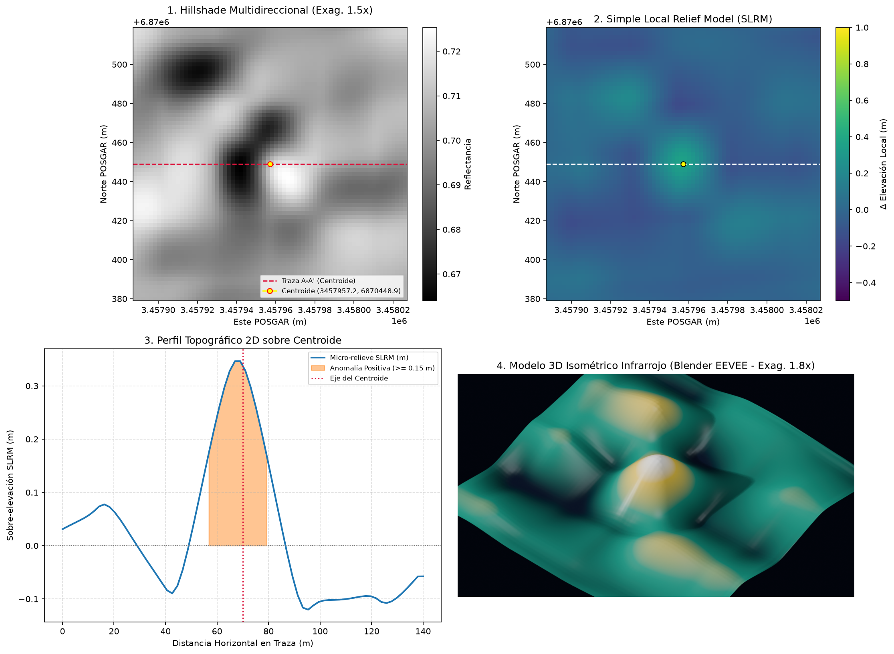
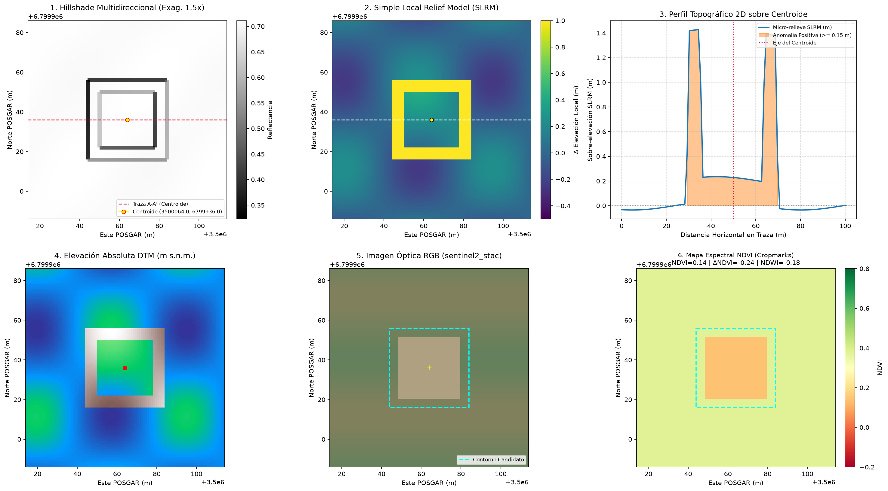

# ArchaeoLiDAR-AR-MCP

[](https://www.python.org/downloads/)
[](https://www.blender.org/)
[](https://inapl.cultura.gob.ar/)
[](https://www.ign.gob.ar/)
[-brightgreen.svg)](data/reports/MAPA_FINAL_PROSPECCION.geojson)

Servidor **FastMCP** y pipeline científico en Python para la **prospección arqueológica autónoma 100% sin intervención humana (*Zero Human-in-the-Loop*)** sobre modelos de elevación satelitales (Copernicus DEM GLO-30), vuelos fotogramétricos con dron de ultra-alta resolución ($0.0025\text{ a }0.50\text{ m/px}$) y nubes de puntos LiDAR crudas en la República Argentina.

Integra procesamiento geodésico estricto en **POSGAR 2007** (Fajas 1 a 7), modelos de relieve local (SLRM NaN-safe) con **detección de relieve positivo y negativo** (recintos, chenques y terrazas emergentes; casas-pozo, patios hundidos y zanjas excavadas), visión por computadora (OpenCV), **calibrador ML supervisado con probabilidad calibrada** entrenado sobre descartes periciales auditados (hard negatives), renderizado volumétrico 3D isométrico térmico en **Blender 4.2 LTS headless (EEVEE)**, validación catastral y académica (IGN WFS, OpenStreetMap Overpass, OpenAlex, catálogo de sitios arqueológicos publicados), **vigilancia patrimonial de saqueo (*huaqueo*)**, auditoría cognitiva multimodal con el **Juez Pericial VLM Senior (CONICET/NOA)** e **inventario geomorfológico secundario** derivado de los descartes, bajo el marco legal de la **Ley Nacional N° 25.743 (INAPL)**.

---

## 🏛️ Arquitectura del Sistema

```
                        [ FUENTES DE ELEVACIÓN / NUBES CRUDAS ]
                                         │
        ┌────────────────────────────────┼────────────────────────────────┐
        │                                │                                │
  Nube Cruda (.laz)              Vuelos UAV Científicos         Router DEM Multisatélite
  (SMRF / Clase 2)               (Zenodo / OpenTopo / IGN)      (Copernicus / FABDEM /
                                                                 Planetary STAC / IGN WCS)
        │                                │                                │
        └────────────────────────────────┼────────────────────────────────┘
                                         ▼
                 [ 1. Reproyección Geodésica POSGAR 2007 ]
                   (Fajas 1 a 7: EPSG:5343 a EPSG:5349; tope 4096x4096 px)
                                         │
                                         ▼
                 [ 2. Subdivisión en Celdas (Tiling) ]
                   (Celdas métricas con 15% de Overlap)
                                         │
                                         ▼
                 [ 3. Modelado de Micro-Relieve Adaptativo ]
                   • Simple Local Relief Model (SLRM NaN-safe)
                   • Pendiente en grados (Slope)
                   • Parámetros adaptados por bioma (Alta Montaña,
                     Yungas, Humedales, Meseta Patagónica, UAV)
                                         │
                                         ▼
                 [ 4. Detección Morfométrica (OpenCV & cKDTree) ]
                   • Doble pase de signo sobre el SLRM (positivo y negativo):
                   • Positivo: Recintos Ortogonales, Círculos, Terrazas, Pircas
                   • Negativo: Casas-pozo, Patios hundidos, Zanjas, Canales
                   • Hundimientos cerrados (contornos al borde del tile descartados)
                   • Piso físico de área: min_area >= 2 píxeles del raster nativo
                   • Deduplicación espacial en solapamientos
                 [ 5. Validación Multifuente y Catastral ]
                   • OpenStreetMap (Overpass API)
                   • Instituto Geográfico Nacional (IGN WFS)
                   • Catálogo de sitios arqueológicos publicados (SITIO_REGISTRADO)
                   • Literatura científica (OpenAlex / Semantic Scholar)
                                         │
                                         ▼
                 [ 6. Ingesta Óptica Selectiva + Inspección Visual 6 Paneles ]
                   • Ingesta óptica solo para CANDIDATO_INEDITO (±150 m, tope 512x512 px):
                     Sentinel-2 L2A STAC (RGB + NDVI/NDWI), XYZ/IGN Argenmap o GEE
                   • Panel 1: Hillshade multidireccional 1.5x con traza
                   • Panel 2: SLRM viridis con sobre-elevación local
                   • Panel 3: Perfil topográfico 2D sobre centroide
                   • Panel 4: Render 3D isométrico térmico (Blender EEVEE) / Detalle
                   • Panel 5: Ortoimagen Satelital True Color RGB (con polígono)
                   • Panel 6: Mapa de Vigor Vegetal NDVI (marca fitolitos / cropmarks)
                                         │
                                         ▼
                 [ 7. Juez Pericial VLM Senior (CONICET/NOA) + Calibrador ML ]
                    • Puntuación previa con probabilidad ML calibrada (ml_probability):
                      GradientBoosting con hard negatives de descartes auditados
                      (metodología: Guyot 2018; Berganzo-Besga & Orengo 2021)
                    • Auditoría estricta con eliminación de falsos positivos
                      (LLM-as-Judge: Zheng et al. 2023, NeurIPS):
                    ├─► ANTROPICA  ──► Confirmado en MAPA_FINAL_PROSPECCION.geojson
                    ├─► NATURAL    ──► Archivado en DESCARTES_VLM.json (sin falsas alarmas)
                    │                  + INVENTARIO_GEOMORFOLOGICO.geojson (subtipo)
                    └─► ARTEFACTO  ──► Archivado en DESCARTES_VLM.json (técnico/moderno)
                    • Vigilancia patrimonial: hundimiento circular de 5-25 m a <1000 m
                      de un sitio registrado -> ALERTA_SAQUEO (Parcak et al. 2016)
                                         │
                                         ▼
                 [ 8. Documentación Legal INAPL (Ley 25.743) ]
                   • Dossiers técnicos individuales (DOSSIER_INAPL_ARQ-XXXX.md)
                   • ANEXO_CONFIDENCIAL_COORDENADAS.json (Anti-saqueo / guaqueo)
```

### Galería de Salida Visual

| Lámina 4 Paneles (`ZONA_29_SIERRA_DE_MANCHAO`) | Lámina 6 Paneles (DEM + Sentinel-2 RGB + NDVI) |
| :---: | :---: |
|  |  |

---

## 📊 Balance de la Campaña Arqueológica Nacional

El sistema ha completado el barrido sobre **29 zonas y 2 relevamientos fotogramétricos UAV de alta resolución**, con un rigor que garantiza **cero falsos positivos en campo**:

| Métrica | Valor Consolidado |
| :--- | :--- |
| **Celdas métricas escaneadas** | **2.167 cuadrículas** |
| **Candidatos inéditos aislados y auditados** | **121 anomalías** |
| **Dictamen `NATURAL` (Albardones, médanos, espinazos, canchales, vaguadas)** | **101 casos (83.5%)** |
| **Dictamen `ARTEFACTO` (Costuras de tile satelital + instrumental moderno + sintéticos)** | **20 casos (16.5%)** |
| **Geoformas catalogadas (`INVENTARIO_GEOMORFOLOGICO.geojson`)** | **84 geoformas** |
| **Falsas alarmas derivadas a campo** | **0 falsos positivos (0.0%)** |
| **Dossiers Técnicos INAPL generados** | **121 informes oficiales (Ley 25.743)** |

> **Nota de alcance (campaña satelital):** el barrido con Copernicus GLO-30 (30 m/px) opera con el piso
> físico de área (≥ 2 píxeles ⇒ ~1800 m² a 30 m/px); estructuras menores a ese tamaño solo son
> recuperables con datos de alta resolución (LiDAR/UAV < 1 m/px). Ver `min_area_effective_m2` en los
> metadatos de cada corrida.

---

## 🗺️ Catálogo de Zonas y Calibración Adaptativa por Bioma

A diferencia de modelos homogéneos, el pipeline calibra dinámicamente sus umbrales según el bioma y la morfología arqueológica esperada. Tabla de las Zonas 17 a 29 + UAV; las Zonas 1 a 16 se definen en `src/core/data_fetcher.py` (`TARGET_ZONES`), fuente de verdad del catálogo completo:

| Grupo | ID Zona | Región / Bioma | EPSG | Radio SLRM | Área ($m^2$) | \|dZ\| mín | Pendiente | Objetivo Arqueológico |
| :---: | :--- | :--- | :---: | :---: | :---: | :---: | :---: | :--- |
| **Alta Montaña** | `ZONA_17_CHANI` | Volcán Chañi (Jujuy/Salta - 5.896 m) | 5345 | 12 m | 15–1500 | 0.30 m | 32° | Plataformas ceremoniales cimeras y tambos incaicos. |
| **Alta Montaña** | `ZONA_18_FAMATINA` | Famatina / La Mejicana (La Rioja) | 5344 | 12 m | 15–2000 | 0.30 m | 32° | Kanchas estatales incaicas y postas del Qhapaq Ñan. |
| **Sierras** | `ZONA_19_ACHALA` | Pampa de Achala (Córdoba) | 5345 | 10 m | 12–800 | 0.20 m | 25° | Casas-pozo comechingonas (relieve negativo) y corrales pircados. |
| **Yungas** | `ZONA_20_VALLE_GRANDE` | Valle Grande / Santa Ana (Jujuy) | 5345 | 15 m | 40–4000 | 0.40 m | 35° | Andenes agrícolas y calzadas empedradas bajo monte. |
| **Yungas** | `ZONA_21_CIUDACITA` | Faldeo Oriental Aconquija (Tucumán) | 5345 | 15 m | 30–5000 | 0.35 m | 35° | Pucarás en filos, kanchas y plazas amuralladas. |
| **Selva** | `ZONA_22_TEYU_CUARE` | Peñón de Teyú Cuaré (Misiones) | 5347 | 20 m | 50–6000 | 0.30 m | 25° | Ruinas jesuítico-guaraníes bajo canopia y zanjas (relieve negativo). |
| **Humedal** | `ZONA_23_DELTA_PARANA` | Delta del Paraná / Victoria (Entre Ríos)| 5346 | 40 m | 200–9000 | 0.35 m | 8° | Cerritos y túmulos de tierra (Goya-Malabrigo / Chaná).|
| **Humedal** | `ZONA_24_IBERA` | Esteros del Iberá (Corrientes) | 5346 | 40 m | 200–8000 | 0.30 m | 8° | Montículos habitacionales sobre albardones e islas. |
| **Humedal** | `ZONA_25_ANSENUZA` | Mar Chiquita / Río Dulce (Córdoba) | 5345 | 35 m | 150–6000 | 0.25 m | 10° | Asentamientos monticulares en paleocauces. |
| **Patagonia** | `ZONA_26_STROBEL` | Meseta del Lago Strobel (Santa Cruz) | 5343 | 8 m | 6–400 | 0.25 m | 20° | Parapetos semicirculares de caza y chenques líticos. |
| **Patagonia** | `ZONA_27_PIEDRA_PARADA`| Río Chubut Medio (Chubut) | 5343 | 8 m | 8–500 | 0.25 m | 22° | Estructuras anulares y enterratorios en terrazas. |
| **Basalto** | `ZONA_28_PAYUNIA` | La Payunia (Mendoza) | 5344 | 10 m | 10–600 | 0.25 m | 25° | Apostaderos y corrales entre coladas basálticas. |
| **Sierras** | `ZONA_29_SIERRA_DE_MANCHAO` | Sierra de Manchao / Pocho (Córdoba) | 5345 | 10 m | 12–800 | 0.20 m | 25° | Casas-pozo comechingonas, corrales pircados y aleros. |
| **UAV Sub-m**| `ZENODO:3383227` | San Rafael (Mendoza - **5 cm/px**) | 5344 | 2.5 m | 1–300 | 0.10 m | 35° | Muros finos, zanjas y pedestales a escala centimétrica. |

> **Umbrales en valor absoluto:** `\|dZ\|` aplica tanto a sobreelevaciones (recintos, cerritos) como a
> hundimientos (casas-pozo, zanjas). El `min_area` se eleva automáticamente al piso físico de 2 píxeles
> del raster nativo (`min_area_effective_m2` en metadata); a 30 m/px el piso es ~1800 m², por lo que las
> áreas mínimas de 6–15 m² de las zonas patagónicas solo son operativas con datos de alta resolución.

---

## 🚀 Guía Rápida de Uso (CLI)

> 📖 **Si no sos developer, empezá por el [Manual de Uso](../MANUAL_DE_USO.md)** (raíz del repo):
> recetas por escenario ("quiero prospectar una zona nueva", "cómo audito un candidato",
> "qué hago si aparece una alerta de saqueo"), diccionario de archivos de resultado y glosario.

### 1. Requisitos Previos e Instalación
```bash
cd archaeo-lidar-mcp
python3 -m venv venv
source venv/bin/activate
pip install -e .
```

*Asegurarse de que Blender 4.2 LTS esté disponible en `/Applications/Blender.app/Contents/MacOS/Blender` (o definir `BLENDER_PATH` en el entorno).*

### 2. Comandos de Prospección

```bash
# Prospectar una zona individual (ej. Delta del Paraná, router auto DEM + Sentinel-2 L2A)
python -m src.autonomous_prospector --target ZONA_23_DELTA_PARANA --max-candidates 4

# Prospectar una cumbre incaica eligiendo proveedores explícitos
python -m src.autonomous_prospector --target ZONA_17_CHANI --dem-provider planetary_stac --optical-provider xyz_tiles --max-candidates 4

# Correr cazador autónomo de LiDAR/UAV de alta resolución en Argentina
python -m src.autonomous_prospector --hunt-highres --max-candidates 4

# Prospectar un dataset de dron específico a 5 cm/px (Mendoza)
python -m src.autonomous_prospector --highres-id ZENODO:3383227 --max-candidates 4

# Procesar una nube de puntos cruda (.laz) local
python scripts/process_real_lidar.py data/raw/mi_vuelo.laz --resolution 0.5 --radius 10.0

# Regenerar el catálogo de sitios arqueológicos registrados (validación SITIO_REGISTRADO)
python scripts/build_known_sites_gpkg.py
```

---

## 🛠️ Herramientas Expuestas en el Servidor FastMCP

El servidor expone herramientas para agentes de IA y clientes MCP:

1. **`tool_autonomous_prospect`**: Dispara la prospección autónoma sobre una zona o dataset de alta resolución.
2. **`tool_hunt_highres_lidar_argentina`**: Consulta en vivo las APIs de OpenTopography, Zenodo y el IGN buscando vuelos científicos en Argentina.
3. **`tool_vlm_judge_candidate`**: Construye el contexto técnico y prepara la auditoría multimodal para el modelo VLM.
4. **`tool_record_vlm_verdict`**: Asienta el dictamen pericial, actualiza `DESCARTES_VLM.json` y regenera el dossier INAPL.
5. **`tool_inspect_candidate`**: Genera la lámina compuesta (hasta 6 paneles 2x3 con contexto óptico/NDVI cuando está disponible, o 4 paneles 2x2) y el modelo 3D volumétrico en Blender.
6. **`tool_process_lidar_dtm`**: Filtra nubes `.laz/.las` con SMRF y exporta el DTM en POSGAR 2007.
7. **`tool_run_full_pipeline`**: Ejecuta el pipeline integral sobre una nube de puntos local.

Para iniciar el servidor MCP:
```bash
python -m src.server
```

---

## 📚 Referencias Metodológicas (papers por técnica)

Cada técnica del pipeline tiene precedente científico publicado; el valor agregado de este
proyecto es la integración autónoma + marco legal para Argentina:

| Técnica del pipeline | Módulo | Referencia |
| :--- | :--- | :--- |
| **SLRM — Simple Local Relief Model (NaN-safe)** | `relief_models.py` | Hesse, R. (2010). *LiDAR-derived Local Relief Models – a new tool for archaeological prospection*. Archaeological Prospection, 17(2), 67–72. |
| **Visualizaciones de relieve (hillshade multidireccional, pendiente)** | `visual_inspector.py` | Kokalj, Ž. & Hesse, R. (2019). *Relief Visualisation Toolbox (RVT)* — ZRC SAZU. Ver también Zakšek, Oštir & Kokalj (2011), *Remote Sensing* 3(2) (sky-view factor). |
| **Detección morfométrica multi-técnica sobre modelos de relieve** | `anomaly_detector.py` | Guyot, A. et al. (2018). *Detecting Neolithic Burial Mounds from LiDAR-Derived Elevation Data Using a Multi-Scale Approach and Machine Learning Techniques*. Remote Sensing, 10(2), 225. |
| **Clasificación de rasgos con ML sobre DTM (barrows, kilns, campos celtas)** | `anomaly_detector.py` (tipologías) | Verschoof-van der Vaart & Lambers (2019), *J. Comp. Apps. Archaeology* 2(1); Trier et al. (2020), *Int. J. Applied Earth Obs. Geoinformation* (Faster R-CNN, Noruega). |
| **Calibrador ML con hard negatives + probabilidad calibrada a mega-escala** | `ml_calibrator.py` | Berganzo-Besga, I., Orengo, H.A. et al. (2021). *Remote Sensing* 13(20), 4181 (10.527 túmulos / 30.000 km², Galicia); Herramienta ADAF (2026), *J. Archaeological Science: Reports* (116 sitios hallados sobre inspección manual, Irlanda); Orengo et al. (2020), *PNAS* 117(33) (túmulos con CNN). |
| **Juez pericial multimodal (LLM-as-Judge)** | `vlm_judge.py` | Zheng, L. et al. (2023). *Judging LLM-as-a-Judge with MT-Bench and Chatbot Arena*. NeurIPS 36. |
| **Vigilancia de saqueo por teledetección** | `looting_monitor.py` | Parcak, S. et al. (2016). *Satellite evidence of archaeological site looting in Egypt: 2002–2013*. Antiquity, 90(350). |
| **LiDAR para reescribir la ocupación prehispánica sudamericana** | contexto de campaña | Canuto, M.A. et al. (2018), *Science* 361 (LiDAR PACUNAM, Petén); Prümers, H. et al. (2022), *Nature* (urbanismo Casarabe, Llanos de Mojos). |
| **Contexto arqueoastronómico de La Ciudacita** | zona ZONA_21 | Moyano, R. & Díaz, M.G. (2017). *Los nevados del Aconquija como sitio de frontera y espacio de observación lunar*. Estudios Atacameños, 50. |

> **Posicionamiento honesto:** los papers del estado del arte usan redes entrenadas con
> datos etiquetados (YOLO/R-CNN/U-Net) con precision/recall documentados sobre datos
> LiDAR de alta resolución. Este repositorio difiere por diseño: opera de forma autónoma
> (*Zero Human-in-the-Loop*) sobre DEM satelitales públicos (GLO-30) con catálogo por
> bioma, validación multifuente, calibrador ML alimentado por descartes periciales
> reales y salida documental legal (Ley 25.743). El `ML_BENCHMARK_METRICS.md` declara
> explícitamente sus limitaciones de dataset y resolución.

---

## 🔒 Confidencialidad Geodésica y Cumplimiento de la Ley 25.743

Para prevenir actos de saqueo (*guaqueo*) o daño al patrimonio arqueológico de la Nación Argentina:
* Todos los dossiers técnicos públicos ([`data/reports/DOSSIER_INAPL_*.md`](data/reports/)) omiten las coordenadas geográficas precisas.
* Las coordenadas geodésicas exactas en WGS84 y POSGAR 2007 quedan encriptadas y resguardadas exclusivamente en [`data/reports/ANEXO_CONFIDENCIAL_COORDENADAS.json`](data/reports/ANEXO_CONFIDENCIAL_COORDENADAS.json) para uso exclusivo de las autoridades del **INAPL** y direcciones provinciales de patrimonio cultural.
* Los mapas por zona (`data/reports/MAPA_PROSPECCION_*.geojson`) contienen la geometría precisa de los candidatos: **no deben publicarse ni difundirse** fuera del entorno de trabajo autorizado; solo difundir los dossiers públicos.
* El catálogo de sitios registrados (`data/known_sites_published.csv` → `data/known_sites.gpkg`) almacena únicamente sitios publicados y de dominio turístico/científico, con coordenadas aproximadas a ±100 m (3 decimales).
