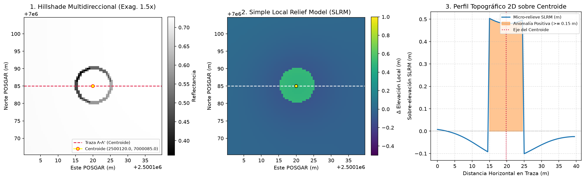

# DOSSIER TÉCNICO DE PROSPECCIÓN ARQUEOLÓGICA REMOTA (LiDAR)
**Autoridad de Aplicación:** Instituto Nacional de Antropología y Pensamiento Latinoamericano (INAPL)
**Marco Legal:** Ley Nacional N° 25.743 - Protección del Patrimonio Arqueológico y Paleontológico
**Código de Candidato:** `ARQ-0025`
**Fecha de Generación (UTC):** `2026-11-12T10:21:21Z`

---

> **AVISO DE CONFIDENCIALIDAD GEODÉSICA (LEY 25.743):**
> Con el objeto de prevenir acciones de saqueo (*guaqueo*) o destrucción intencional, las coordenadas
> puntuales WGS84 y POSGAR 2007 han sido omitidas de este documento principal y resguardadas en el
> archivo cifrado/aislado `ANEXO_CONFIDENCIAL_COORDENADAS.json`.

---

## ⭐ Conclusión Ejecutiva (respuesta directa)

❌ **NO — la anomalía es un artefacto técnico o un error del mapa**

**¿Qué es?** Origen del rasgo: Estructura circular sintética: anillo plantado sobre el DTM de validación (synthetic_posgar_faja2_dtm), no sobre terreno real relevado.
**Certeza del juicio:** `95%` · **Prioridad de investigación:** BAJA (descartado)

**Próximo paso:** ninguno — archivado como descarte (queda en `DESCARTES_VLM.json` y `INVENTARIO_GEOMORFOLOGICO.geojson` como dato geomorfológico).

| Parámetro | Valor |
| :--- | :--- |
| **Veredicto pericial** | **ARTEFACTO** |

---

## 1. Síntesis de Detección y Clasificación Patrimonial

| Parámetro | Valor Registrado |
| :--- | :--- |
| **ID de Anomalía** | `ARQ-0025` |
| **Clasificación Preliminar** | **CANDIDATO_INEDITO** |
| **Tipología Morfológica** | `estructura_circular` |
| **Índice de Confianza Algorítmica** | `0.945` |
| **Faja Métrica de Cálculo** | `EPSG:5344` (POSGAR 2007) |
| **Bioma / Entorno** | `N/D` |
| **Contexto Arqueológico Esperado** | `N/D` |

---

## 2. Métricas Morfométricas y Microtopográficas (SLRM)

- **Área Estimada en Planta:** `73.99 m²`
- **Índice de Rectangularidad:** `0.7916`
- **Índice de Circularidad Isoperimétrica:** `0.9694`
- **Sobre-elevación Local Media (SLRM):** `0.53 m`
- **Distancia al Curso de Agua más Próximo (IGN):** `No determinado (sin datos IGN)`

---

## 3. Verificación de Nube de Puntos Cruda e Inspección Multimodal

- **Densidad de Retornos de Suelo (ASPRS Clase 2):** `N/D pts/m²`
- **Puntaje de Integridad del Perfil Transversal:** `N/D`
- **Lámina Compuesta (Hillshade 1.5x + SLRM + Perfil + 3D):** `data/processed/synthetic_posgar_faja2_dtm_ARQ-0025_composite.png`
- **Modelo 3D Isométrico Térmico/Infrarrojo (Blender EEVEE):** `N/D`
- **Gráfico de Corte Transversal (Cross-Section):** `N/D`

**Figura 1 — Lámina compuesta de 4 paneles** (1: Hillshade 1.5x · 2: SLRM · 3: Perfil 2D · 4: Render 3D Blender):

---

## 4. Anexo Reservado de Coordenadas

Las coordenadas exactas de replanteo para inspección en campo por personal autorizado del **INAPL** o
direcciones provinciales de patrimonio se encuentran en:
- Archivo: `ANEXO_CONFIDENCIAL_COORDENADAS.json`

---

## 5. Juicio Pericial de Inteligencia Artificial Multimodal

| Campo | Dictamen |
| :--- | :--- |
| **Veredicto final** | **ARTEFACTO** |
| **Nivel de certeza** | `95%` |
| **Interpretación funcional** | Estructura circular sintética: anillo plantado sobre el DTM de validación (synthetic_posgar_faja2_dtm), no sobre terreno real relevado. |
| **¿Inspección terrestre / dron?** | **NO** |
| **Backend evaluador** | `agente pericial in situ (modo mcp_host, Juez Senior CONICET/NOA)` |

**Justificación geomorfológica:** Panel 1 (Hillshade): anillo circular perfecto de grosor constante, sin variación, sin ruido de fondo en el resto del tile (terreno plano homogéneo = DEM sintético). Panel 2 (SLRM): meseta circular uniforme con borde limpio, sin brechas de muro ni desgaste: un chenque o corral real erosionado nunca presenta continuidad perfecta. Panel 3 (Perfil): piso plano con paredes verticales y hombros nítidos: firma de estructura plantada por software. Fuente del DTM: synthetic_posgar_faja2_dtm.tif (data/raw), corrida de validación previa. No derivar personal a las coordenadas del anexo.
