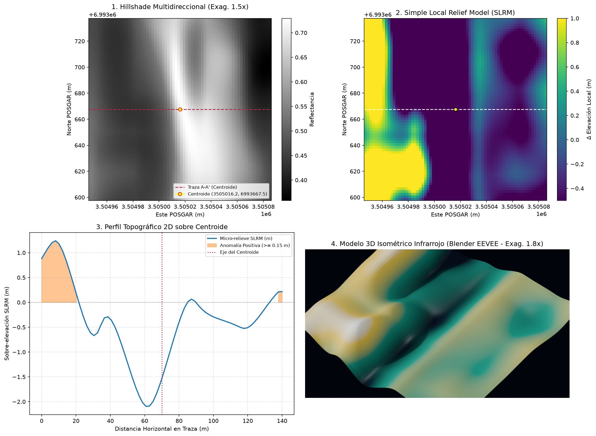

# DOSSIER TÉCNICO DE PROSPECCIÓN ARQUEOLÓGICA REMOTA (LiDAR)
**Autoridad de Aplicación:** Instituto Nacional de Antropología y Pensamiento Latinoamericano (INAPL)
**Marco Legal:** Ley Nacional N° 25.743 - Protección del Patrimonio Arqueológico y Paleontológico
**Código de Candidato:** `ARQ-CIU-0005`
**Fecha de Generación (UTC):** `2026-11-12T04:08:59Z`

---

> **AVISO DE CONFIDENCIALIDAD GEODÉSICA (LEY 25.743):**
> Con el objeto de prevenir acciones de saqueo (*guaqueo*) o destrucción intencional, las coordenadas
> puntuales WGS84 y POSGAR 2007 han sido omitidas de este documento principal y resguardadas en el
> archivo cifrado/aislado `ANEXO_CONFIDENCIAL_COORDENADAS.json`.

---

## ⭐ Conclusión Ejecutiva (respuesta directa)

❌ **NO — la anomalía corresponde a una geoforma natural**

**¿Qué es?** La forma del terreno responde a: Canal de escorrentía / quebrada encajonada natural N-S de ~200 m de longitud, 25 m de ancho y ~1.9 m de profundidad.
**Certeza del juicio:** `90%` · **Prioridad de investigación:** BAJA (descartado)

**Próximo paso:** ninguno — archivado como descarte (queda en `DESCARTES_VLM.json` y `INVENTARIO_GEOMORFOLOGICO.geojson` como dato geomorfológico).

| Parámetro | Valor |
| :--- | :--- |
| **Veredicto pericial** | **NATURAL** |

---

## 1. Síntesis de Detección y Clasificación Patrimonial

| Parámetro | Valor Registrado |
| :--- | :--- |
| **ID de Anomalía** | `ARQ-CIU-0005` |
| **Clasificación Preliminar** | **CANDIDATO_INEDITO** |
| **Tipología Morfológica** | `zanja_lineal` |
| **Índice de Confianza Algorítmica** | `0.85` |
| **Faja Métrica de Cálculo** | `EPSG:5344` (POSGAR 2007) |
| **Bioma / Entorno** | `yungas_montana` |
| **Contexto Arqueológico Esperado** | `Pucarás en filos de montaña, plazas amuralladas (kanchas) y recintos satélites.` |

---

## 2. Métricas Morfométricas y Microtopográficas (SLRM)

- **Área Estimada en Planta:** `2379.48 m²`
- **Índice de Rectangularidad:** `0.567`
- **Índice de Circularidad Isoperimétrica:** `0.1279`
- **Sobre-elevación Local Media (SLRM):** `-1.397 m`
- **Distancia al Curso de Agua más Próximo (IGN):** `No determinado (sin datos IGN)`

---

## 3. Verificación de Nube de Puntos Cruda e Inspección Multimodal

- **Densidad de Retornos de Suelo (ASPRS Clase 2):** `N/D pts/m²`
- **Puntaje de Integridad del Perfil Transversal:** `N/D`
- **Lámina Compuesta (Hillshade 1.5x + SLRM + Perfil + 3D):** `data/processed/zona_21_ciudacita_ARQ-CIU-0005_composite.png`
- **Modelo 3D Isométrico Térmico/Infrarrojo (Blender EEVEE):** `N/D`
- **Gráfico de Corte Transversal (Cross-Section):** `N/D`

**Figura 1 — Lámina compuesta de 4 paneles** (1: Hillshade 1.5x · 2: SLRM · 3: Perfil 2D · 4: Render 3D Blender):

---

## 4. Anexo Reservado de Coordenadas

Las coordenadas exactas de replanteo para inspección en campo por personal autorizado del **INAPL** o
direcciones provinciales de patrimonio se encuentran en:
- Archivo: `ANEXO_CONFIDENCIAL_COORDENADAS.json`

---

## 5. Juicio Pericial de Inteligencia Artificial Multimodal

| Campo | Dictamen |
| :--- | :--- |
| **Veredicto final** | **NATURAL** |
| **Nivel de certeza** | `90%` |
| **Interpretación funcional** | Canal de escorrentía / quebrada encajonada natural N-S de ~200 m de longitud, 25 m de ancho y ~1.9 m de profundidad. |
| **¿Inspección terrestre / dron?** | **NO** |
| **Backend evaluador** | `agente pericial in situ (modo mcp_host, Juez Senior CONICET/NOA)` |

**Justificación geomorfológica:** Panel 1: surco lineal al pie de una ladera (hillshade brillante al oeste) con trazas de escurrimiento difusas, sin revestimiento, sin bermas ni alineaciones de muro. Panel 2: franja negativa continua N-S flanqueada por talud positivo al este (borde de ladera) y lóbulo amarillo SW (esquina del tile, artefacto de borde SLRM). Panel 3: perfil V-U suave de 1.9 m sin fondo plano ni paredes verticales construidas. Panel 4: canal fluvial natural. Morfología clásica de cárcava/cauce de escorrentía en yungas de alta pendiente, no de zanja o canal construido.
