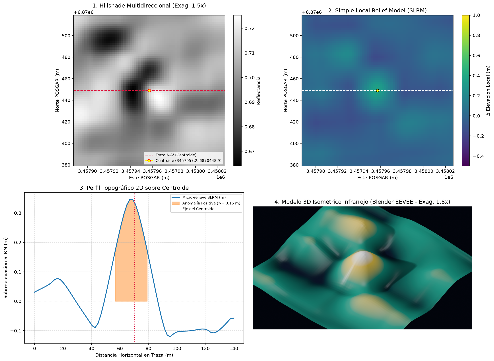

# DOSSIER TÉCNICO DE PROSPECCIÓN ARQUEOLÓGICA REMOTA (LiDAR)
**Autoridad de Aplicación:** Instituto Nacional de Antropología y Pensamiento Latinoamericano (INAPL)
**Marco Legal:** Ley Nacional N° 25.743 - Protección del Patrimonio Arqueológico y Paleontológico
**Código de Candidato:** `ARQ-MAN-0004`
**Fecha de Generación (UTC):** `2026-11-12T04:08:59Z`

---

> **AVISO DE CONFIDENCIALIDAD GEODÉSICA (LEY 25.743):**
> Con el objeto de prevenir acciones de saqueo (*guaqueo*) o destrucción intencional, las coordenadas
> puntuales WGS84 y POSGAR 2007 han sido omitidas de este documento principal y resguardadas en el
> archivo cifrado/aislado `ANEXO_CONFIDENCIAL_COORDENADAS.json`.

---

## ⭐ Conclusión Ejecutiva (respuesta directa)

❌ **NO — la anomalía corresponde a una geoforma natural**

**¿Qué es?** La forma del terreno responde a: Loma suave alargada en ladera (~45 m de base, resalte 0.35 m).
**Certeza del juicio:** `88%` · **Prioridad de investigación:** BAJA (descartado)

**Próximo paso:** ninguno — archivado como descarte (queda en `DESCARTES_VLM.json` y `INVENTARIO_GEOMORFOLOGICO.geojson` como dato geomorfológico).

| Parámetro | Valor |
| :--- | :--- |
| **Veredicto pericial** | **NATURAL** |

---

## 1. Síntesis de Detección y Clasificación Patrimonial

| Parámetro | Valor Registrado |
| :--- | :--- |
| **ID de Anomalía** | `ARQ-MAN-0004` |
| **Clasificación Preliminar** | **CANDIDATO_INEDITO** |
| **Tipología Morfológica** | `estructura_circular` |
| **Índice de Confianza Algorítmica** | `0.98` |
| **Faja Métrica de Cálculo** | `EPSG:5344` (POSGAR 2007) |
| **Bioma / Entorno** | `sierras_centrales` |
| **Contexto Arqueológico Esperado** | `Casas-pozo comechingonas semi-enterradas (relieve negativo), corrales pircados, morteros y aleros en las laderas occidentales.` |

---

## 2. Métricas Morfométricas y Microtopográficas (SLRM)

- **Área Estimada en Planta:** `327.46 m²`
- **Índice de Rectangularidad:** `0.8269`
- **Índice de Circularidad Isoperimétrica:** `1.0895`
- **Sobre-elevación Local Media (SLRM):** `0.277 m`
- **Distancia al Curso de Agua más Próximo (IGN):** `No determinado (sin datos IGN)`

---

## 3. Verificación de Nube de Puntos Cruda e Inspección Multimodal

- **Densidad de Retornos de Suelo (ASPRS Clase 2):** `N/D pts/m²`
- **Puntaje de Integridad del Perfil Transversal:** `N/D`
- **Lámina Compuesta (Hillshade 1.5x + SLRM + Perfil + 3D):** `data/processed/zona_29_sierra_de_manchao_ARQ-MAN-0004_composite.png`
- **Modelo 3D Isométrico Térmico/Infrarrojo (Blender EEVEE):** `N/D`
- **Gráfico de Corte Transversal (Cross-Section):** `N/D`

**Figura 1 — Lámina compuesta de 4 paneles** (1: Hillshade 1.5x · 2: SLRM · 3: Perfil 2D · 4: Render 3D Blender):

---

## 4. Anexo Reservado de Coordenadas

Las coordenadas exactas de replanteo para inspección en campo por personal autorizado del **INAPL** o
direcciones provinciales de patrimonio se encuentran en:
- Archivo: `ANEXO_CONFIDENCIAL_COORDENADAS.json`

---

## 5. Juicio Pericial de Inteligencia Artificial Multimodal

| Campo | Dictamen |
| :--- | :--- |
| **Veredicto final** | **NATURAL** |
| **Nivel de certeza** | `88%` |
| **Interpretación funcional** | Loma suave alargada en ladera (~45 m de base, resalte 0.35 m). |
| **¿Inspección terrestre / dron?** | **NO** |
| **Backend evaluador** | `agente pericial in situ (modo mcp_host, Juez Senior CONICET/NOA)` |

**Justificación geomorfológica:** Panel 1: ladera NW escarpada y piso SE, sin trazas de pirca ni geometría. Panel 2: positivo difuso alargado sin estructura interna. Panel 3: campana continua de 0.35 m sobre 45 m, sin paredes ni meseta interior. Panel 4: domo liso. Misma firma que MAN-0001/0002: microrelieve residual de la ladera capturado por el umbral de dZ (0.20 m) apenas por encima del piso de ruido del supermuestreo; sin evidencia arquitectónica.
