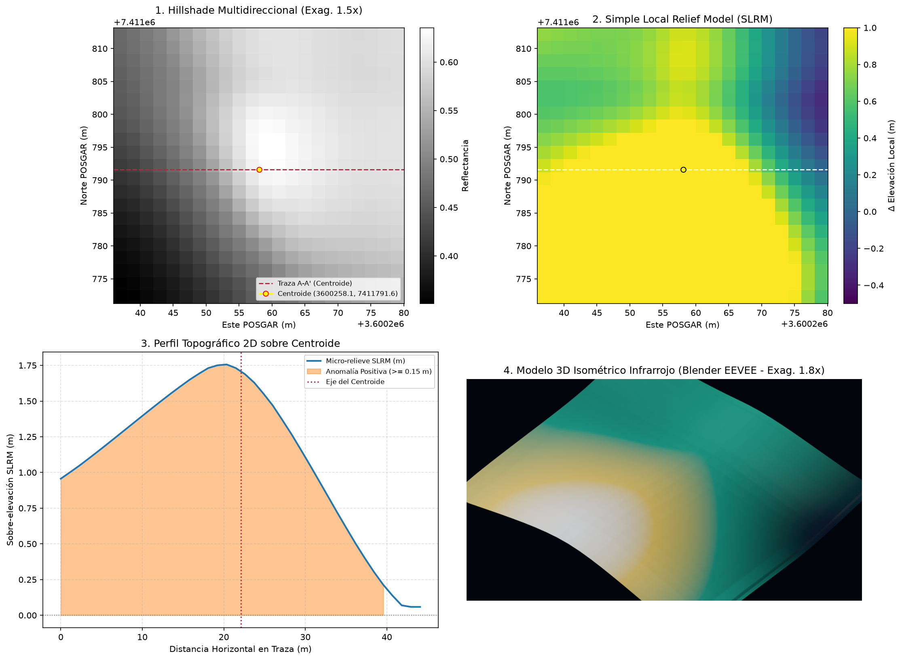

# DOSSIER TÉCNICO DE PROSPECCIÓN ARQUEOLÓGICA REMOTA (LiDAR)
**Autoridad de Aplicación:** Instituto Nacional de Antropología y Pensamiento Latinoamericano (INAPL)
**Marco Legal:** Ley Nacional N° 25.743 - Protección del Patrimonio Arqueológico y Paleontológico
**Código de Candidato:** `ARQ-VGR-0002`
**Fecha de Generación (UTC):** `2026-11-12T10:41:37Z`

---

> **AVISO DE CONFIDENCIALIDAD GEODÉSICA (LEY 25.743):**
> Con el objeto de prevenir acciones de saqueo (*guaqueo*) o destrucción intencional, las coordenadas
> puntuales WGS84 y POSGAR 2007 han sido omitidas de este documento principal y resguardadas en el
> archivo cifrado/aislado `ANEXO_CONFIDENCIAL_COORDENADAS.json`.

---

## ⭐ Conclusión Ejecutiva (respuesta directa)

❌ **NO — la anomalía corresponde a una geoforma natural**

**¿Qué es?** La forma del terreno responde a: Loma convexa en ladera (~42 m de base, resalte 1.75 m), sin geometría anular.
**Certeza del juicio:** `88%` · **Prioridad de investigación:** BAJA (descartado)

**Próximo paso:** ninguno — archivado como descarte (queda en `DESCARTES_VLM.json` y `INVENTARIO_GEOMORFOLOGICO.geojson` como dato geomorfológico).

| Parámetro | Valor |
| :--- | :--- |
| **Veredicto pericial** | **NATURAL** |

---

## 1. Síntesis de Detección y Clasificación Patrimonial

| Parámetro | Valor Registrado |
| :--- | :--- |
| **ID de Anomalía** | `ARQ-VGR-0002` |
| **Clasificación Preliminar** | **CANDIDATO_INEDITO** |
| **Tipología Morfológica** | `estructura_circular` |
| **Índice de Confianza Algorítmica** | `0.98` |
| **Faja Métrica de Cálculo** | `EPSG:5344` (POSGAR 2007) |
| **Bioma / Entorno** | `yungas_selva` |
| **Contexto Arqueológico Esperado** | `Andenería agrícola prehispánica, calzadas empedradas y recintos bajo monte.` |

---

## 2. Métricas Morfométricas y Microtopográficas (SLRM)

- **Área Estimada en Planta:** `147.46 m²`
- **Índice de Rectangularidad:** `0.752`
- **Índice de Circularidad Isoperimétrica:** `1.0782`
- **Sobre-elevación Local Media (SLRM):** `1.568 m`
- **Distancia al Curso de Agua más Próximo (IGN):** `No determinado (sin datos IGN)`

---

## 3. Verificación de Nube de Puntos Cruda e Inspección Multimodal

- **Densidad de Retornos de Suelo (ASPRS Clase 2):** `N/D pts/m²`
- **Puntaje de Integridad del Perfil Transversal:** `N/D`
- **Lámina Compuesta (Hillshade 1.5x + SLRM + Perfil + 3D):** `data/processed/zona_20_valle_grande_ARQ-VGR-0002_composite.png`
- **Modelo 3D Isométrico Térmico/Infrarrojo (Blender EEVEE):** `N/D`
- **Gráfico de Corte Transversal (Cross-Section):** `N/D`

**Figura 1 — Lámina compuesta de 4 paneles** (1: Hillshade 1.5x · 2: SLRM · 3: Perfil 2D · 4: Render 3D Blender):

---

## 4. Anexo Reservado de Coordenadas

Las coordenadas exactas de replanteo para inspección en campo por personal autorizado del **INAPL** o
direcciones provinciales de patrimonio se encuentran en:
- Archivo: `ANEXO_CONFIDENCIAL_COORDENADAS.json`

---

## 5. Juicio Pericial de Inteligencia Artificial Multimodal

| Campo | Dictamen |
| :--- | :--- |
| **Veredicto final** | **NATURAL** |
| **Nivel de certeza** | `88%` |
| **Interpretación funcional** | Loma convexa en ladera (~42 m de base, resalte 1.75 m), sin geometría anular. |
| **¿Inspección terrestre / dron?** | **NO** |
| **Backend evaluador** | `agente pericial in situ (modo mcp_host, Juez Senior CONICET/NOA)` |

**Justificación geomorfológica:** Panel 1: gradiente suave sin sombras de muro perimetral ni anillo. Panel 2: plateau positivo difuso con escalones de bloque de píxel nativo en el borde NE/SE (artefacto de remuestreo). Panel 3: campana asimétrica continua de 1.75 m sin piso interior ni muros de corral. Panel 4: domo sin paredes. Un corral circular de 147 m2 (d~14 m) mostraría anillo discontinuo de 0.3-0.5 m y traza lineal en hillshade; ambas ausentes.
